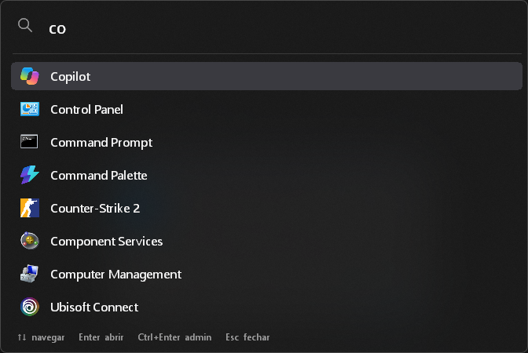

# Busca Rápida

Aperte **Alt + Espaço** em qualquer lugar do Windows, digite parte do nome e aperte **Enter**. Ele mostra só os seus apps: nada de resultados da web, propagandas ou "recomendados".

*[English below](#english)*

## Como instalar

1. **[Clique aqui para baixar o BuscaRapida.exe](https://github.com/reuel-freitas/busca-rapida/releases/latest/download/BuscaRapida.exe)**
2. Abra o arquivo baixado.
3. Pronto. Vai aparecer uma mensagem confirmando a instalação.

Não precisa de senha de administrador. O app já abre sozinho quando o Windows liga.

### "O Windows protegeu o computador"

O app é novo e não tem assinatura digital paga, por isso o Windows pode mostrar esse aviso na primeira vez:

1. Clique em **Mais informações**.
2. Clique em **Executar assim mesmo**.

Se o navegador disser que o arquivo "não é baixado com frequência", clique nos **três pontinhos** ao lado do download e escolha **Manter**.

## Como usar

| Tecla | O que faz |
|---|---|
| **Alt + Espaço** | Abre ou fecha a busca |
| Digitar | Filtra os apps (pode ser só um pedaço: `vsc` acha *Visual Studio Code*) |
| **↑ ↓** | Escolhe o app |
| **Enter** ou clique | Abre o app |
| **Ctrl + Enter** | Abre como administrador |
| **Esc** | Fecha |

Os apps que você mais usa vão subindo na lista.

## Desinstalar

Clique com o botão direito no ícone da **lupa** perto do relógio (se não aparecer, clique na setinha **^**) e escolha **Desinstalar**.

---

## English

Press **Alt + Space** anywhere in Windows, type part of an app's name and hit **Enter**. It shows only your apps: no web results, no ads, no "recommended".

### Install

1. **[Download BuscaRapida.exe](https://github.com/reuel-freitas/busca-rapida/releases/latest/download/BuscaRapida.exe)**
2. Open the downloaded file. A message confirms the installation.

No admin rights needed, and it starts automatically with Windows.

If Windows shows **"Windows protected your PC"**, click **More info** → **Run anyway**. The app isn't signed with a paid certificate, so Windows warns about it the first time.

### Use

**Alt + Space** opens/closes · type to filter · **↑ ↓** select · **Enter** or click opens · **Ctrl + Enter** runs as admin · **Esc** closes.

### Uninstall

Right-click the **magnifier** icon near the clock → **Desinstalar** (Uninstall).

---

## Para desenvolvedores / For developers

Feito em [AutoHotkey v2](https://www.autohotkey.com/). O código fica todo em [`BuscaRapida.ahk`](BuscaRapida.ahk).

- **Rodar sem compilar:** instale o AutoHotkey v2 e abra o `BuscaRapida.ahk`.
- **Gerar o .exe:** rode `.\build.ps1` (requer o [Ahk2Exe](https://github.com/AutoHotkey/Ahk2Exe/releases)). O arquivo sai em `dist\BuscaRapida.exe`.
- **Configurar:** atalho, cores, transparência do vidro e pastas extras de apps portáteis ficam no topo do script.

## Licença / License

[MIT](LICENSE)
